  

  

  
  
  

### Hi, I'm Zhijie Wang 👋

I teach math (Calculus, Algebra II, SAT) at Dublin Christian Academy in New Hampshire and write software on the side. B.S. in Computer Science and Mathematics, Gordon College, 2024.

🏀 Coding in the AI era feels like playing next to Jordan: I call the play and make the pass, he drops 30.

#### What I've built

- **[going-going-gone-live](https://github.com/andrew-wzj/going-going-gone-live)** (C# · ASP.NET Core · SignalR): a real-time auction for the art board game I use in class. Students bid from their phones. [Play it →](https://going-going-gone-live.onrender.com)
- **[grpc-jobworker](https://github.com/andrew-wzj/grpc-jobworker)** (Go): runs shell commands as background jobs, with gRPC and REST APIs, live output and mutual TLS.
- **[housing-lottery-sim](https://github.com/andrew-wzj/housing-lottery-sim)** (Python): a strategy-proof housing lottery, tested on 1,000 simulated lotteries. [Case study →](https://andrew-wzj.github.io/reactportfolio/housing-lottery/)
- **[reactportfolio](https://github.com/andrew-wzj/reactportfolio)** (React + Vite): my portfolio and live resume. [View →](https://andrew-wzj.github.io/reactportfolio/)

#### Tools

Go · Python · C# / ASP.NET Core · SignalR · React · gRPC · Docker · SQL

📫 zw0726ang@gmail.com · 🌐 [Portfolio](https://andrew-wzj.github.io/reactportfolio/)
